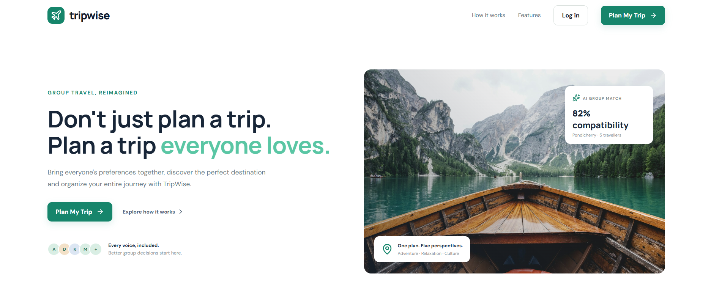
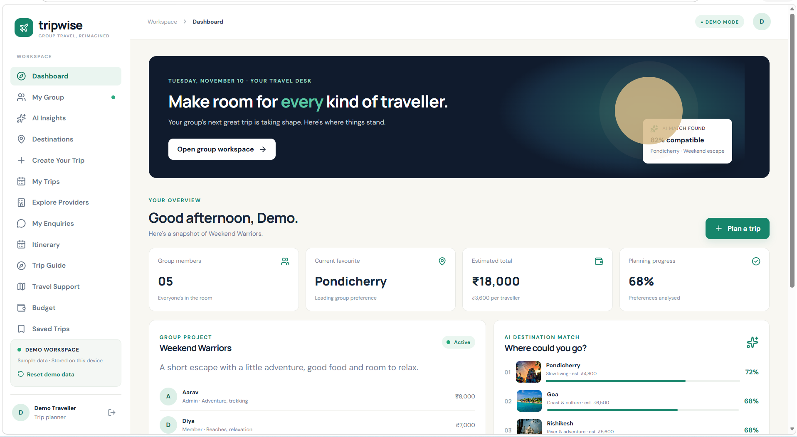
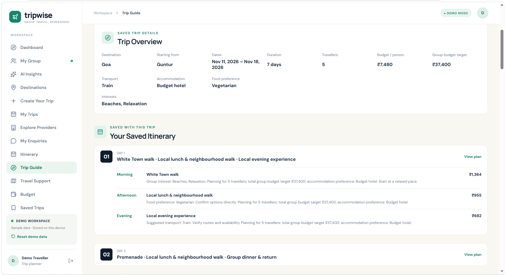
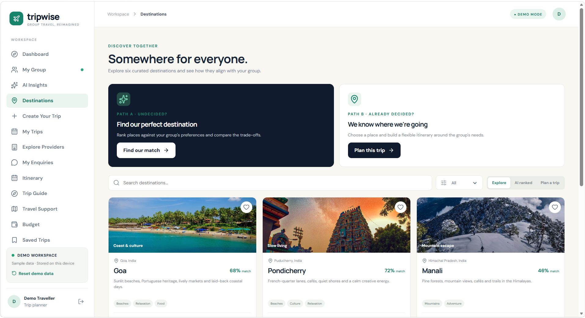

# TripWise – Your Trip. Everyone’s Choice. ✈️

**Plan together. Travel better.**

TripWise is an AI-powered group travel planning platform designed to make planning trips with friends and family easier. It brings trip creation, group preferences, itinerary planning, budgeting, travel guides, and provider discovery together in one place.

🌐 **Live Demo:** https://tripwise-fawn.vercel.app

📂 **GitHub Repository:** https://github.com/Suryaprasad13092007/TripWise

---

## ✨ Features

- **Trip Creation:** Create trips with destinations, dates, traveller details, budgets, and preferences.
- **Group Planning:** Coordinate travel decisions through group discussions, polls, and insights.
- **Trip Guide:** Explore attractions, day-by-day itineraries, transport, accommodation, food, activities, and travel tips.
- **Budget Planning:** View estimated trip expenses and budget breakdowns.
- **Provider Marketplace:** Explore sample accommodation, transport, restaurant, and activity listings.
- **My Trips:** Access and manage created trips.
- **Saved Trips:** Save trips for quick access later.
- **Enquiry Management:** Submit and view demo enquiries.

## 📸 Screenshots

### 1. Home Page


### 2. Dashboard


### 3. Trip Guide


### 4. Destinations


## 🛠️ Tech Stack

- React
- TypeScript
- Vite
- Tailwind CSS
- Browser Local Storage
- Vercel

## 🚀 Getting Started

Follow these steps to run TripWise locally.

### 1. Clone the repository

```bash
git clone https://github.com/Suryaprasad13092007/TripWise.git
```

### 2. Navigate to the project folder

```bash
cd TripWise
```

### 3. Install dependencies

```bash
npm install
```

### 4. Start the development server

```bash
npm run dev
```

Open the local URL displayed in your terminal.

### 5. Build for production

```bash
npm run build
```

## 📌 Important Notes

- TripWise currently uses demo provider listings and demo enquiry workflows. It does not make confirmed bookings.
- Prices and budgets should be treated as estimates unless independently verified.
- Browser Local Storage is used for certain data, so saved information is limited to the same browser and device.

## 🔮 Future Enhancements

- Real-time hotel and transport availability.
- Secure user authentication and cloud database integration.
- Live booking and payment integration.
- Advanced AI-powered destination recommendations.
- Real-time group collaboration and notifications.

## 👨‍💻 Project

**TripWise – Group Travel Planning Platform**

Built as a project to simplify group travel planning through technology.

---

⭐ If you find this project interesting, consider giving the repository a star!